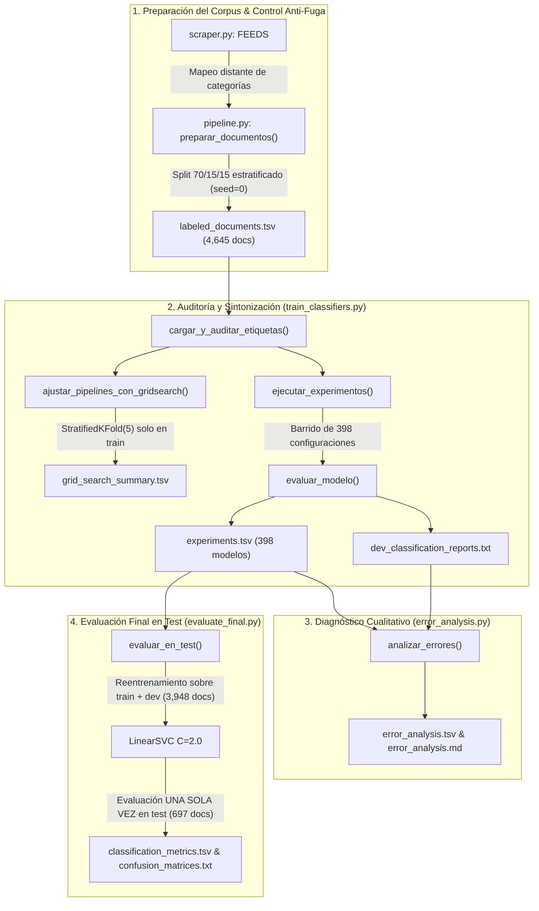

# Módulo de Clasificación Supervisada de Noticias (Etapa II - Tarea A)

> Esta carpeta usa como entrada la salida de `2. Preprocesamiento (Scrapper, Normalizacion, Vectorial)/resultados/3 Lematizado/Frecuencia/Corpus KM01/`.
> Los resultados de clasificación se guardan exclusivamente en `resultados/`.

## Organización de resultados

```text
resultados/
├── 01_experimentacion/
│   ├── experiments.tsv
│   └── grid_search_summary.tsv
├── 02_metricas_y_predicciones/
│   ├── classification_metrics.tsv
│   ├── classification_predictions.tsv
│   └── per_class_metrics.tsv
├── 03_reportes/
│   ├── dev_classification_reports.txt
│   └── confusion_matrices.txt
└── 04_analisis_errores/
    ├── error_analysis.tsv
    └── error_analysis.md
```

La separación distingue el registro de experimentos, las métricas y predicciones, los reportes
formales y el análisis cualitativo de errores exigidos por el PDF.
## Documentación Técnica Detallada de Funciones, Pipelines y Metodología Experimental

Este documento describe en profundidad la arquitectura de software, la lógica matemática y el desglose **función por función** implementado en este módulo para resolver la **Tarea A (Clasificación Supervisada de Noticias)**, en estricto apego a los requerimientos de la guía docente oficial ([`Proyecto_01_Noticias_Etapa_II.pdf`](file:///c:/Users/Arthy/NLP/nlp2.0/Proyecto%20PLN/recursos/guias_docente/Proyecto_01_Noticias_Etapa_II.pdf)).

---

## 🗺️ 1. Arquitectura General y Flujo de Ejecución

El siguiente diagrama ilustra cómo interactúan los scripts y funciones desde la ingesta del corpus hasta la evaluación ciega final:



---

## 📚 2. Desglose Exhaustivo de Funciones Archivo por Archivo

A continuación se detalla cada función que interviene en la clasificación supervisada, indicando su archivo fuente, firma, propósito, parámetros, lógica interna y relación directa con las especificaciones del profesor.

---

### Módulo Principal: [`train_classifiers.py`](file:///c:/Users/Arthy/NLP/nlp2.0/Proyecto%20PLN/fase_2_aprendizaje/Supervisada/train_classifiers.py)

#### 1. `cargar_y_auditar_etiquetas()`
* **Ubicación:** Líneas [87–127](file:///c:/Users/Arthy/NLP/nlp2.0/Proyecto%20PLN/fase_2_aprendizaje/Supervisada/train_classifiers.py#L87-L127)
* **Requisito del PDF:** *Sección 6 — "Document the annotation/label mapping procedure, class distribution, and treatment of missing or ambiguous labels."*
* **Firma:** `def cargar_y_auditar_etiquetas() -> pd.DataFrame`
* **Entradas:** Carga [`data/processed/labeled_documents.tsv`](file:///c:/Users/Arthy/NLP/nlp2.0/Proyecto%20PLN/data/processed/labeled_documents.tsv).
* **Salida:** DataFrame verificado y filtrado de 4,645 documentos.
* **Lógica Interna y Funcionamiento Detallado:**
  1. **Auditoría de integridad:** Aplica máscaras booleanas para detectar textos vacíos (`df["text"].str.strip().eq("")`), categorías vacías, identificadores duplicados y etiquetas que no pertenezcan al conjunto canónico de 10 clases (`CATEGORIAS_CANONICAS`).
  2. **Tratamiento de ambigüedades:** La asignación de etiquetas es *distante* (derivada del feed RSS temático de origen). Si un artículo fue sindicado en múltiples secciones a la vez, el desambiguador determinista de [`scraper.py`](file:///c:/Users/Arthy/NLP/nlp2.0/Proyecto%20PLN/fase_1_recuperacion/scraper/scraper.py#L46-L150) le asigna de manera estricta la primera categoría encontrada según el orden de precedencia de feeds.
  3. **Comprobación de distribución y desbalance:** Genera una tabla de contingencia con `pd.crosstab(df["category"], df["split"])` mostrando exactamente la repartición estratificada 70% `train` (3,251), 15% `dev` (697) y 15% `test` (697).
  4. **Cálculo del ratio de desbalance:** Compara la clase mayoritaria (`ciencia`: 738 noticias) frente a la minoritaria (`sociedad`: 374 noticias), arrojando un ratio de **$1.97\times$**, justificando matemáticamente por qué la métrica primaria del proyecto debe ser **Macro-F1** y no simple *Accuracy*.

---

#### 2. `ajustar_pipelines_con_gridsearch(df_docs)`
* **Ubicación:** Líneas [130–239](file:///c:/Users/Arthy/NLP/nlp2.0/Proyecto%20PLN/fase_2_aprendizaje/Supervisada/train_classifiers.py#L130-L239)
* **Requisito del PDF:** *Secciones 3, 6 y 9 — "Use traditional machine learning and reproducible scikit-learn-style Pipelines", "Tune classifier hyperparameters using the training partition and compare candidate pipelines on dev", "Controlled search (GridSearchCV) for supervised tuning."*
* **Firma:** `def ajustar_pipelines_con_gridsearch(df_docs: pd.DataFrame) -> pd.DataFrame`
* **Entradas:** `df_docs` (DataFrame con las particiones `train` y `dev`).
* **Salidas:** Genera [`resultados/grid_search_summary.tsv`](file:///c:/Users/Arthy/NLP/nlp2.0/Proyecto%20PLN/fase_2_aprendizaje/Supervisada/resultados/grid_search_summary.tsv) y retorna el DataFrame con el resumen de sintonización.
* **Lógica Interna y Funcionamiento Detallado:**
  1. **Aislamiento absoluto contra fuga de datos (*Data Leakage*):** Extrae exclusivamente los textos de `train` ($X_{train}$) y sus etiquetas ($y_{train}$). Ni la partición `dev` ni la partición `test` intervienen en el ajuste de los vocabularios ni en el cálculo de IDF.
  2. **Estructura de Pipelines Scikit-Learn:** Cada candidato se ensambla como un objeto `Pipeline` compuesto de etapas secuenciales:
     * `Pipeline([('vect', TfidfVectorizer()), ('clf', Clasificador())])`
     * En el modelo alternativo: `Pipeline([('vect', TfidfVectorizer()), ('svd', TruncatedSVD(100)), ('clf', RandomForestClassifier())])`
  3. **Validación Cruzada Estratificada:** Configura `StratifiedKFold(n_splits=5, shuffle=True, random_state=0)` para garantizar que cada uno de los 5 pliegues de validación interna conserve exactamente las proporciones de las 10 categorías.
  4. **Optimización formal por Macro-F1:** Se pasa explícitamente `scoring="f1_macro"`, forzando a que la búsqueda encuentre los hiperparámetros que maximicen el promedio no ponderado de F1 entre todas las clases.
  5. **Malla de hiperparámetros explorada (`param_grid`):**
     * **MultinomialNB:** `vect__ngram_range`: $[(1,1), (1,2)]$, `vect__stop_words`: $[None, \text{'english'}]$, `clf__alpha`: $[0.01, 0.1, 0.5, 1.0]$.
     * **LogisticRegression:** `vect__ngram_range`: $[(1,1), (1,2)]$, `vect__stop_words`: $[None, \text{'english'}]$, `clf__C`: $[1.0, 5.0, 10.0]$ con `max_iter=500`, `tol=1e-3`.
     * **LinearSVC:** `vect__ngram_range`: $[(1,1), (1,2)]$, `vect__stop_words`: $[None, \text{'english'}]$, `clf__C`: $[0.1, 0.5, 1.0, 2.0]$.
     * **RandomForestClassifier + SVD:** `TruncatedSVD(100)` con `clf__n_estimators`: $[50, 100]$ y `clf__max_depth`: $[15, 25]$.
  6. **Evaluación de control en `dev`:** Con el mejor estimador (`grid.best_estimator_`), predice sobre el conjunto de desarrollo independiente ($X_{dev}$) y calcula tanto el `accuracy` como el `dev_macro_f1` para comparar la capacidad de generalización.

---

#### 3. `evaluar_modelo(modelo, X_train, y_train, X_dev, y_dev)`
* **Ubicación:** Líneas [242–262](file:///c:/Users/Arthy/NLP/nlp2.0/Proyecto%20PLN/fase_2_aprendizaje/Supervisada/train_classifiers.py#L242-L262)
* **Requisito del PDF:** *Sección 6 — "Use macro-F1 as the PRIMARY model-selection metric. Report accuracy, macro precision/recall/F1."*
* **Firma:** `def evaluar_modelo(modelo, X_train, y_train, X_dev, y_dev) -> dict`
* **Entradas:** Estimador instanciado, matrices dispersas CSR de entrenamiento y desarrollo, vectores de etiquetas.
* **Salida:** Diccionario con tiempos de cómputo, predicciones en `dev`, `accuracy`, `macro_precision`, `macro_recall` y `macro_f1`.
* **Lógica Interna:**
  1. Cronometra el ajuste `modelo.fit(X_train, y_train)` con precisión de milisegundos (`time.time()`).
  2. Genera predicciones `preds_dev = modelo.predict(X_dev)`.
  3. Calcula rigurosamente las métricas con `zero_division=0`:
     $$\text{Macro-Precision} = \frac{1}{|C|} \sum_{c \in C} \text{Precision}_c, \quad \text{Macro-Recall} = \frac{1}{|C|} \sum_{c \in C} \text{Recall}_c, \quad \text{Macro-F1} = \frac{1}{|C|} \sum_{c \in C} \frac{2 \cdot P_c \cdot R_c}{P_c + R_c}$$

---

#### 4. `ejecutar_experimentos()`
* **Ubicación:** Líneas [264–555](file:///c:/Users/Arthy/NLP/nlp2.0/Proyecto%20PLN/fase_2_aprendizaje/Supervisada/train_classifiers.py#L264-L555)
* **Requisito del PDF:** *Secciones 5, 6, 9, 11 y Apéndice — Bitácora experimental exhaustiva (`experiments.tsv`), reportes por clase (`per_class_metrics.tsv`), métricas comparativas (`classification_metrics.tsv`) y matrices de confusión (`confusion_matrices.txt`).*
* **Firma:** `def ejecutar_experimentos() -> dict`
* **Lógica Interna y Funcionamiento Detallado:**
  1. **Orquestación del barrido factorial de 398 configuraciones:**
     Itera sistemáticamente a través de los directorios de matrices generados en el pipeline:
     * **3 Normalizaciones:** `1 Tokenizado` (mínimo), `2 Stop words` (filtrado léxico), `3 Lematizado` (SpaCy `en_core_web_sm`).
     * **3 Ponderaciones:** `Binario`, `Frecuencia` (TF) y `TD IDF`.
     * **4 Rangos de N-gramas:** `unigramas`, `unigramas_bigramas`, `bigramas` y `unigramas_bigramas_trigramas`.
     * Espacios matriciales base: $3 \times 3 \times 4 = 36$ espacios de características.
     * En cada espacio evalúa: 4 valores de $\alpha$ para `MultinomialNB`, 4 valores de $C$ para `LinearSVC` y 3 valores de $C$ para `LogisticRegression` ($36 \times 11 = 396$).
     * Más 2 experimentos adicionales con reducción de dimensionalidad `TruncatedSVD` (100 y 300 componentes latentes), completando los **398 experimentos**.
  2. **Identificación de los mejores modelos por familia:**
     Mantiene un registro del mejor experimento de cada algoritmo (`MultinomialNB` $\rightarrow$ `C222`, `LogisticRegression` $\rightarrow$ `C98`, `LinearSVC` $\rightarrow$ `C239`) y marca con `selected = "yes"` únicamente a estos tres en [`experiments.tsv`](file:///c:/Users/Arthy/NLP/nlp2.0/Proyecto%20PLN/fase_2_aprendizaje/Supervisada/resultados/experiments.tsv).
  3. **Exportación de entregables tabulares:**
     * Escribe [`classification_metrics.tsv`](file:///c:/Users/Arthy/NLP/nlp2.0/Proyecto%20PLN/fase_2_aprendizaje/Supervisada/resultados/classification_metrics.tsv) con las métricas en `dev` de los 3 seleccionados.
     * Escribe [`classification_predictions.tsv`](file:///c:/Users/Arthy/NLP/nlp2.0/Proyecto%20PLN/fase_2_aprendizaje/Supervisada/resultados/classification_predictions.tsv) con las $3 \times 697 = 2,091$ predicciones individuales en `dev`.
     * Desglosa [`per_class_metrics.tsv`](file:///c:/Users/Arthy/NLP/nlp2.0/Proyecto%20PLN/fase_2_aprendizaje/Supervisada/resultados/per_class_metrics.tsv) con Precision, Recall, F1 y soporte para cada una de las 10 categorías temáticas.
     * Genera [`confusion_matrices.txt`](file:///c:/Users/Arthy/NLP/nlp2.0/Proyecto%20PLN/fase_2_aprendizaje/Supervisada/resultados/confusion_matrices.txt) formateando en texto la matriz $10 \times 10$ de cada modelo en desarrollo.
     * Guarda [`dev_classification_reports.txt`](file:///c:/Users/Arthy/NLP/nlp2.0/Proyecto%20PLN/fase_2_aprendizaje/Supervisada/resultados/dev_classification_reports.txt) con la salida textual completa de `classification_report`.

---

### Módulo de Diagnóstico: [`error_analysis.py`](file:///c:/Users/Arthy/NLP/nlp2.0/Proyecto%20PLN/fase_2_aprendizaje/Supervisada/error_analysis.py)

#### 5. `analizar_errores()`
* **Ubicación:** Líneas [19–130](file:///c:/Users/Arthy/NLP/nlp2.0/Proyecto%20PLN/fase_2_aprendizaje/Supervisada/error_analysis.py#L19-L130)
* **Requisito del PDF:** *Secciones 6 y 12 — "Inspect at least ten misclassified dev documents where feasible and explain likely causes."*
* **Firma:** `def analizar_errores() -> None`
* **Entradas:** Lee [`classification_predictions.tsv`](file:///c:/Users/Arthy/NLP/nlp2.0/Proyecto%20PLN/fase_2_aprendizaje/Supervisada/resultados/classification_predictions.tsv), [`classification_metrics.tsv`](file:///c:/Users/Arthy/NLP/nlp2.0/Proyecto%20PLN/fase_2_aprendizaje/Supervisada/resultados/classification_metrics.tsv) y [`labeled_documents.tsv`](file:///c:/Users/Arthy/NLP/nlp2.0/Proyecto%20PLN/data/processed/labeled_documents.tsv).
* **Salidas:** Genera [`resultados/error_analysis.tsv`](file:///c:/Users/Arthy/NLP/nlp2.0/Proyecto%20PLN/fase_2_aprendizaje/Supervisada/resultados/error_analysis.tsv) y el reporte [`resultados/error_analysis.md`](file:///c:/Users/Arthy/NLP/nlp2.0/Proyecto%20PLN/fase_2_aprendizaje/Supervisada/resultados/error_analysis.md).
* **Lógica Interna y Funcionamiento Detallado:**
  1. Identifica automáticamente cuál fue el modelo campeón en `dev` (en este caso, `LinearSVC` con ID `C239`).
  2. Filtra las predicciones donde la etiqueta real (`gold_label`) difiere de la predicha (`predicted_label`): encuentra **185 errores sobre 697 noticias (tasa de error del 26.54%)**.
  3. Realiza un conteo de los pares de confusión más frecuentes:
     * `medio_ambiente` $\rightarrow$ `ciencia` (11 veces)
     * `economia` $\rightarrow$ `tecnologia_ia` (11 veces)
     * `sociedad` $\rightarrow$ `politica` (10 veces)
     * `salud` $\rightarrow$ `ciencia` (9 veces)
     * `tecnologia_ia` $\rightarrow$ `ciencia` (7 veces)
  4. Extrae una muestra representativa de **12 casos cualitativos distintos** (superando el requisito de 10) y clasifica automáticamente la causa lingüística de la confusión:
     * *Intersección geopolítica:* Declaraciones de líderes políticos en contextos bélicos (`politica` vs `mundo_conflictos`).
     * *Economía política:* Regulación fiscal, presupuestos y aranceles comerciales (`politica` vs `economia`).
     * *Frontera científica difusa:* Estudios de cambio climático o biotecnología clasificados como ciencia general (`medio_ambiente` / `salud` vs `ciencia`).
     * *Textos breves o truncados:* Noticias cuyo título y descripción en el feed RSS contienen menos de 80 caracteres.

---

### Módulo de Evaluación Oficial: [`evaluate_final.py`](file:///c:/Users/Arthy/NLP/nlp2.0/Proyecto%20PLN/fase_2_aprendizaje/Supervisada/evaluate_final.py)

#### 6. `evaluar_en_test()`
* **Ubicación:** Líneas [33–192](file:///c:/Users/Arthy/NLP/nlp2.0/Proyecto%20PLN/fase_2_aprendizaje/Supervisada/evaluate_final.py#L33-L192)
* **Requisito del PDF:** *Secciones 4, 6 y 11 — "Once the configuration is frozen, refit only the best model and configuration on train+dev (without test) and report final test metrics once. Never tune against test scores."*
* **Firma:** `def evaluar_en_test() -> None`
* **Entradas:** Carga el campeón desde [`experiments.tsv`](file:///c:/Users/Arthy/NLP/nlp2.0/Proyecto%20PLN/fase_2_aprendizaje/Supervisada/resultados/experiments.tsv), las matrices $X_{train}, X_{dev}, X_{test}$ y las etiquetas de `labeled_documents.tsv`.
* **Salidas:** Incorpora la fila `experiment_id = "test"` en [`classification_metrics.tsv`](file:///c:/Users/Arthy/NLP/nlp2.0/Proyecto%20PLN/fase_2_aprendizaje/Supervisada/resultados/classification_metrics.tsv), las 697 predicciones en [`classification_predictions.tsv`](file:///c:/Users/Arthy/NLP/nlp2.0/Proyecto%20PLN/fase_2_aprendizaje/Supervisada/resultados/classification_predictions.tsv) y la matriz final en [`confusion_matrices.txt`](file:///c:/Users/Arthy/NLP/nlp2.0/Proyecto%20PLN/fase_2_aprendizaje/Supervisada/resultados/confusion_matrices.txt).
* **Lógica Interna y Protocolo Metodológico:**
  1. **Determinación ciega del ganador:** Lee la bitácora y selecciona el experimento con mayor Macro-F1 en validación (`C239`: `LinearSVC`, $C=2.0$, normalización `stop_words`, representación `tfidf unigramas_bigramas`).
  2. **Fusión estricta de particiones conocidas:** Utiliza `scipy.sparse.vstack` para concatenar horizontalmente las matrices de entrenamiento y desarrollo:
     $$X_{\text{train+dev}} = \begin{bmatrix} X_{\text{train}} \\ X_{\text{dev}} \end{bmatrix} \in \mathbb{R}^{3948 \times 128993}, \quad y_{\text{train+dev}} = [y_{\text{train}} \mid y_{\text{dev}}] \in \mathbb{R}^{3948}$$
  3. **Reentrenamiento sin mirar `test`:** Ajusta una única instancia de `LinearSVC(C=2.0, max_iter=3000, random_state=0)` exclusivamente con los 3,948 ejemplos disponibles.
  4. **Evaluación final ciega:** Ejecuta `modelo_final.predict(X_test)` sobre los 697 documentos de prueba reservados desde el inicio del proyecto.
  5. **Métricas oficiales finales alcanzadas en `test`:**
     * **Exactitud (Accuracy):** **`73.03%`**
     * **Macro-Precision:** **`0.7135`**
     * **Macro-Recall:** **`0.7147`**
     * **Macro-F1:** **`0.7114`**

---

### Funciones Auxiliares de Soporte en la Pipeline

Para tener el mapa completo, estas funciones externas suministran los datos y matrices al módulo de clasificación:

| Función | Archivo Fuente | Rol en el Proyecto |
| :--- | :--- | :--- |
| **`FEEDS` (Diccionario)** | [`fase_1_recuperacion/scraper/scraper.py`](file:///c:/Users/Arthy/NLP/nlp2.0/Proyecto%20PLN/fase_1_recuperacion/scraper/scraper.py#L51-L150) | Define la taxonomía canónica de 10 categorías y el orden de desambiguación para el etiquetado distante de noticias. |
| **`preparar_documentos(corpus)`** | [`fase_2_aprendizaje/pipeline/pipeline.py`](file:///c:/Users/Arthy/NLP/nlp2.0/Proyecto%20PLN/fase_2_aprendizaje/pipeline/pipeline.py#L64-L79) | Concatena `title + " " + description`, ejecuta `train_test_split(70/15/15, stratify=category, random_state=0)` y asigna la columna `split`. |
| **`crear_vectorizador()`** | [`fase_2_aprendizaje/pipeline/representaciones.py`](file:///c:/Users/Arthy/NLP/nlp2.0/Proyecto%20PLN/fase_2_aprendizaje/pipeline/representaciones.py#L19-L22) | Fabrica instancias de `CountVectorizer` o `TfidfVectorizer` parametrizadas por esquema binario, frecuencia o TF-IDF. |
| **`guardar_representaciones()`** | [`fase_2_aprendizaje/pipeline/representaciones.py`](file:///c:/Users/Arthy/NLP/nlp2.0/Proyecto%20PLN/fase_2_aprendizaje/pipeline/representaciones.py#L46-L87) | Aplica `vectorizador.fit(textos["train"])` y `transform()` estricto para `dev` y `test`, garantizando que ninguna palabra de validación o prueba contamine el vocabulario. |

---

## 🔬 3. Explicación Dinámica de `GridSearchCV` y Scikit-Learn `Pipeline`s

### ¿Por qué se utilizó `Pipeline`?
En procesamiento de lenguaje natural tradicional, si se normaliza el texto o se calcula la matriz TF-IDF sobre todo el corpus antes de separar en folds de validación cruzada, **la frecuencia inversa de documento (IDF) del conjunto de validación se filtra al conjunto de entrenamiento**. 

Para evitar esta anomalía metodológica (*data leakage*):
```python
pipeline = Pipeline([
    ("vect", TfidfVectorizer()),
    ("clf", LinearSVC(max_iter=3000, random_state=0))
])
```
Al pasar este pipeline a `GridSearchCV`, Scikit-Learn garantiza que en cada una de las 5 divisiones:
1. Solo los 4 pliegues de entrenamiento son procesados con `vect.fit_transform()`.
2. El pliegue restante de validación únicamente recibe `vect.transform()`.

### Resultados Comparativos de `GridSearchCV` ([`grid_search_summary.tsv`](file:///c:/Users/Arthy/NLP/nlp2.0/Proyecto%20PLN/fase_2_aprendizaje/Supervisada/resultados/grid_search_summary.tsv))

| Modelo | Mejores Hiperparámetros (CV Train) | CV Train Macro-F1 | Dev Accuracy | Dev Macro-F1 | Tiempo |
| :--- | :--- | :---: | :---: | :---: | :---: |
| **LogisticRegression** | `C=10.0`, `ngram=(1, 2)`, `stop_words='english'` | 0.6829 | 0.7446 | **0.7327** | 66.3s |
| **LinearSVC** | `C=1.0`, `ngram=(1, 2)`, `stop_words='english'` | 0.6804 | 0.7331 | **0.7194** | 7.3s |
| **MultinomialNB** | `alpha=0.1`, `ngram=(1, 1)`, `stop_words='english'` | 0.6699 | 0.7346 | **0.7188** | 9.6s |
| **RandomForest + SVD** | `max_depth=15`, `n_estimators=100`, `SVD(100)` | 0.6126 | 0.6499 | **0.6325** | 37.3s |

> **Hallazgo Clave para la Exposición:** El modelo lineal disperso (`LogisticRegression` y `LinearSVC`) supera ampliamente al ensamble de árboles con reducción latente (`RandomForest + SVD`, $0.6325$ F1). Esto demuestra que en PLN de noticias, la información semántica discriminante reside en palabras específicas de alta frecuencia en un espacio de muy alta dimensionalidad ($>100,000$ términos), el cual es linealmente separable.

---

## 📊 4. Tabla de Correspondencia: Requisitos del Docente vs Código

| Requisito en Guía Oficial (PDF) | Función que lo Implementa | Archivo Fuente | Salida Generada |
| :--- | :--- | :--- | :--- |
| **Etiquetado, distribución y ambigüedades** | `cargar_y_auditar_etiquetas()` | [`train_classifiers.py`](file:///c:/Users/Arthy/NLP/nlp2.0/Proyecto%20PLN/fase_2_aprendizaje/Supervisada/train_classifiers.py#L87) | Consola y reporte de distribución estratificada. |
| **Uso de Scikit-Learn Pipelines** | `ajustar_pipelines_con_gridsearch()` | [`train_classifiers.py`](file:///c:/Users/Arthy/NLP/nlp2.0/Proyecto%20PLN/fase_2_aprendizaje/Supervisada/train_classifiers.py#L130) | Objetos `Pipeline` con vectorización y modelo. |
| **Sintonización con `GridSearchCV`** | `ajustar_pipelines_con_gridsearch()` | [`train_classifiers.py`](file:///c:/Users/Arthy/NLP/nlp2.0/Proyecto%20PLN/fase_2_aprendizaje/Supervisada/train_classifiers.py#L130) | [`grid_search_summary.tsv`](file:///c:/Users/Arthy/NLP/nlp2.0/Proyecto%20PLN/fase_2_aprendizaje/Supervisada/resultados/grid_search_summary.tsv) |
| **Comparar ≥3 clasificadores + alternativo** | `ejecutar_experimentos()` | [`train_classifiers.py`](file:///c:/Users/Arthy/NLP/nlp2.0/Proyecto%20PLN/fase_2_aprendizaje/Supervisada/train_classifiers.py#L264) | MultinomialNB, LogReg, LinearSVC, RandomForest+SVD. |
| **Métrica primaria Macro-F1 y reportes** | `evaluar_modelo()` | [`train_classifiers.py`](file:///c:/Users/Arthy/NLP/nlp2.0/Proyecto%20PLN/fase_2_aprendizaje/Supervisada/train_classifiers.py#L242) | [`dev_classification_reports.txt`](file:///c:/Users/Arthy/NLP/nlp2.0/Proyecto%20PLN/fase_2_aprendizaje/Supervisada/resultados/dev_classification_reports.txt) y [`per_class_metrics.tsv`](file:///c:/Users/Arthy/NLP/nlp2.0/Proyecto%20PLN/fase_2_aprendizaje/Supervisada/resultados/per_class_metrics.tsv). |
| **Inspección de ≥10 errores en dev** | `analizar_errores()` | [`error_analysis.py`](file:///c:/Users/Arthy/NLP/nlp2.0/Proyecto%20PLN/fase_2_aprendizaje/Supervisada/error_analysis.py#L19) | [`error_analysis.tsv`](file:///c:/Users/Arthy/NLP/nlp2.0/Proyecto%20PLN/fase_2_aprendizaje/Supervisada/resultados/error_analysis.tsv) y [`error_analysis.md`](file:///c:/Users/Arthy/NLP/nlp2.0/Proyecto%20PLN/fase_2_aprendizaje/Supervisada/resultados/error_analysis.md). |
| **Reentrenamiento en train+dev y test único** | `evaluar_en_test()` | [`evaluate_final.py`](file:///c:/Users/Arthy/NLP/nlp2.0/Proyecto%20PLN/fase_2_aprendizaje/Supervisada/evaluate_final.py#L33) | [`classification_metrics.tsv`](file:///c:/Users/Arthy/NLP/nlp2.0/Proyecto%20PLN/fase_2_aprendizaje/Supervisada/resultados/classification_metrics.tsv) (fila `test`). |

---

## 🚀 5. Comandos de Reproducción Rápida

Para reproducir la fase supervisada, ejecuta desde `FASE 2`:

```powershell
# 1. Auditoría de etiquetas, búsqueda GridSearchCV y barrido de 398 configuraciones:
python ".\3. Fase Supervisada y No Supervisada\Supervisada\programas\train_classifiers.py"

# 2. Extracción y diagnóstico de los casos de error en validación:
python ".\3. Fase Supervisada y No Supervisada\Supervisada\programas\error_analysis.py"

# 3. Reajuste del modelo campeón sobre train+dev y evaluación ciega final en test:
python ".\3. Fase Supervisada y No Supervisada\Supervisada\programas\evaluate_final.py"
```

