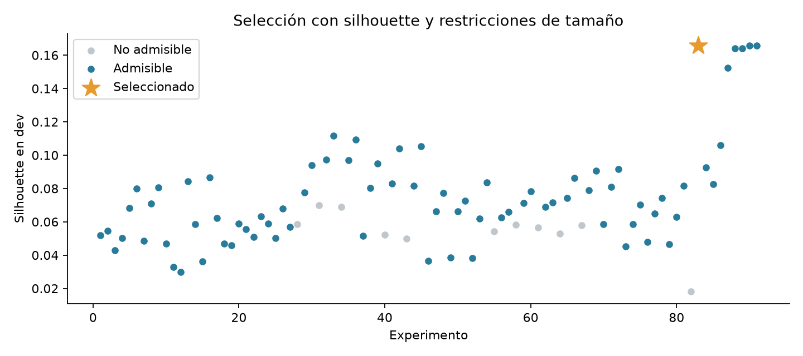
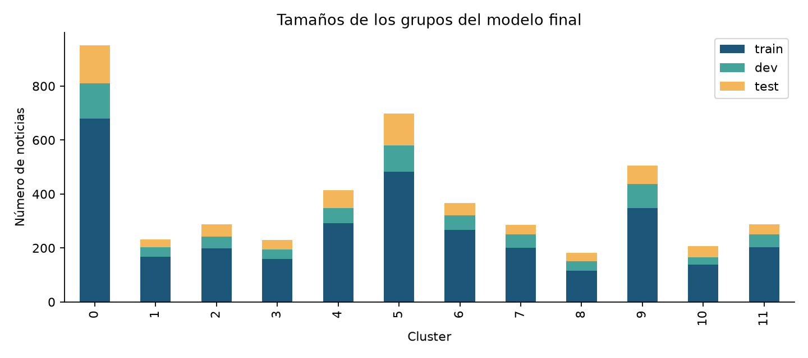

# Aprendizaje no supervisado de noticias con K-Means

Proyecto Etapa II - Tarea B. Resultados ejecutados el 17 de noviembre de 2026. Elaboración conjunta de todos los integrantes del equipo.

Autores del trabajo: Ricardo Hernandez Espinoza; Diana Karen Espinoza Diaz; Byron Robles Lozano; Hector Arturo Saenz Buttanda; Diamanda Abigail Zurita Salinas.

## Objetivo y alcance

Agrupar noticias por similitud textual e identificar temas o eventos recurrentes. Se implementa únicamente K-Means. Este informe cubre la tarea no supervisada; la clasificación supervisada y su integración en el informe general pertenecen al otro módulo.

## Corpus y control de fuga de información

Se reutilizaron las 4,645 noticias y los identificadores del proyecto. Entrada: título + descripción; se verificó coincidencia exacta de textos y categorías con news_raw_corpus_4645.tsv. Se conservaron las particiones existentes: 3,251 train, 697 dev y 697 test (70/15/15, estratificadas originalmente con random_state=0). No se recolectaron noticias nuevas ni se modificó el benchmark de etapa I.

La columna category no se suministra a vectorizadores, SVD, K-Means ni al selector. Las categorías proceden del feed RSS de origen; solo se usan al final para ARI/NMI y tablas de contingencia externas. Los parámetros aprendidos se ajustan únicamente en train durante la selección. Una vez congelada la configuración se reajusta el pipeline completo en train + dev, incluidos vocabulario, IDF y SVD. Test se usa después para la evidencia final, sin escoger configuraciones a partir de sus resultados.

## Configuraciones y metodología

Se reutiliza NormalizadorNoticias del pipeline del equipo. Mínima: texto original con minúsculas y tokenización del vectorizador. Sin stopwords: tokenización y lista inglesa de scikit-learn. Lemas: limpieza de texto/boilerplate y lematización inglesa spaCy en_core_web_sm 3.8.0 con filtrado POS; no es solamente lematización ni equivale exactamente a la lista de stopwords. Estas transformaciones fijas se calculan antes de vectorizar sin aprender estadísticas del corpus.

Se compararon Binary CountVectorizer, frecuencia CountVectorizer y TF-IDF; rangos (1,1), (1,2) y (1,3). Los dos últimos incluyen unigramas y bigramas, y unigramas, bigramas y trigramas respectivamente. No se exploran las siete combinaciones posibles: el PDF pide probar rangos y combinaciones, no exige el producto completo. Vocabulario: min_df=2, max_df=0.95, max_features=30,000, aprendidos en train. Estos límites reducen términos raros y el costo de cómputo, pero pueden perder eventos poco frecuentes.

El factorial inicial cruza 3 normalizaciones x 3 representaciones x 3 rangos x k en {4,8,12}: 81 experimentos, SVD=100, n_init=10, init=k-means++, max_iter=300. Después se comparan SVD sin reducción/50/150, k=6/10 y cambios individuales de n_init (1,20), init (random) y max_iter (100,500), manteniendo los demás parámetros del mejor candidato de la etapa. Es una búsqueda escalonada controlada, no exhaustiva. Semilla principal fija: 0.

Después de SVD (cuando se usa) se aplica normalización L2. K-Means optimiza distancia euclidiana en ese espacio; silhouette se mide en el mismo espacio y con distancia euclidiana sobre los 697 documentos dev completos, sin muestreo. Sin SVD se usa el espacio léxico disperso normalizado L2. Se registran vectores cero: estos se conservan, su asignación puede ser poco informativa y se informa su cantidad. Si solo se ocupa un grupo, silhouette queda sin definir y ese experimento se descarta.

Se ejecutaron 91 experimentos de selección, más tres ajustes de estabilidad. Regla registrada antes de los experimentos: todos los k grupos deben aparecer en dev, cada uno con al menos 1% de dev y ninguno con más de 65%; entre candidatos admisibles gana el mayor silhouette sin redondear (desempate por primer ID). Son umbrales de diseño, no una garantía de coherencia temática. No se fuerza k=10 ni se usa el número de categorías para fijarlo. La interpretación cualitativa posterior documenta límites del resultado y no reabre la selección con test.

## Resultados de selección en dev

Ganador: KM083; normalización=sin_stopwords; representación=binaria; n-gramas=[1, 2]; SVD=50; k=12; n_init=10; init=k-means++; max_iter=300; silhouette dev=0.1658.

Mejores candidatos admisibles (modelo ajustado solo en train):

- KM083: sin_stopwords, binaria, ngram=(1, 2), SVD=50.0, k=12; silhouette=0.1658; tamaños dev=[55, 108, 155, 27, 48, 56, 45, 30, 41, 59, 37, 36].

- KM090: sin_stopwords, binaria, ngram=(1, 2), SVD=50.0, k=12; silhouette=0.1658; tamaños dev=[55, 108, 155, 27, 48, 56, 45, 30, 41, 59, 37, 36].

- KM091: sin_stopwords, binaria, ngram=(1, 2), SVD=50.0, k=12; silhouette=0.1658; tamaños dev=[55, 108, 155, 27, 48, 56, 45, 30, 41, 59, 37, 36].

- KM088: sin_stopwords, binaria, ngram=(1, 2), SVD=50.0, k=12; silhouette=0.1641; tamaños dev=[115, 58, 53, 42, 54, 37, 36, 94, 43, 107, 27, 31].

- KM089: sin_stopwords, binaria, ngram=(1, 2), SVD=50.0, k=12; silhouette=0.1640; tamaños dev=[30, 42, 107, 45, 58, 56, 150, 28, 18, 57, 70, 36].

- KM087: sin_stopwords, binaria, ngram=(1, 2), SVD=50.0, k=12; silhouette=0.1525; tamaños dev=[147, 65, 55, 42, 107, 47, 18, 37, 27, 35, 60, 57].

Mayor silhouette sin restricciones: KM090 (0.1658), admisible=True; tamaños dev=[55, 108, 155, 27, 48, 56, 45, 30, 41, 59, 37, 36]. En esta corrida el máximo global también es admisible. Las restricciones permiten descartar otras particiones con grupos extremos; no cambiaron el ganador respecto al máximo global.

## Efecto de cambiar un factor

Las siguientes parejas del factorial mantienen los demás factores constantes. Se muestra la mayor diferencia absoluta por factor para ilustrar sensibilidad, no una mejora universal; todas las parejas están en comparaciones_controladas.tsv. Las medias del archivo resumen_factores.tsv son descriptivas y no sustituyen estas comparaciones.

- k: KM043 (4, 0.0501) frente a KM045 (12, 0.1054); cambio B-A=+0.0554; admisibles A/B=False/True.

- ngram: KM010 ((1, 1), 0.0470) frente a KM016 ((1, 3), 0.0865); cambio B-A=+0.0395; admisibles A/B=True/True.

- normalization: KM015 (minima, 0.0362) frente a KM042 (sin_stopwords, 0.1039); cambio B-A=+0.0677; admisibles A/B=True/True.

- representation: KM006 (binaria, 0.0798) frente a KM015 (frecuencia, 0.0362); cambio B-A=-0.0437; admisibles A/B=True/True.

Base para comparar SVD y refinamiento de k: KM033, silhouette=0.1117.

- KM082 (svd): SVD=nan, k=12, n_init=10, init=k-means++, max_iter=300; silhouette=0.0181; admisible=False.

- KM083 (svd): SVD=50.0, k=12, n_init=10, init=k-means++, max_iter=300; silhouette=0.1658; admisible=True.

- KM084 (svd): SVD=150.0, k=12, n_init=10, init=k-means++, max_iter=300; silhouette=0.0925; admisible=True.

- KM085 (k_refinement): SVD=100.0, k=6, n_init=10, init=k-means++, max_iter=300; silhouette=0.0825; admisible=True.

- KM086 (k_refinement): SVD=100.0, k=10, n_init=10, init=k-means++, max_iter=300; silhouette=0.1061; admisible=True.

- KM087 (n_init): SVD=50.0, k=12, n_init=1, init=k-means++, max_iter=300; silhouette=0.1525; admisible=True.

- KM088 (n_init): SVD=50.0, k=12, n_init=20, init=k-means++, max_iter=300; silhouette=0.1641; admisible=True.

- KM089 (init): SVD=50.0, k=12, n_init=10, init=random, max_iter=300; silhouette=0.1640; admisible=True.

- KM090 (max_iter): SVD=50.0, k=12, n_init=10, init=k-means++, max_iter=100; silhouette=0.1658; admisible=True.

- KM091 (max_iter): SVD=50.0, k=12, n_init=10, init=k-means++, max_iter=500; silhouette=0.1658; admisible=True.

Cambios que no modifican las asignaciones o el silhouette no justifican afirmar mejoras; aumentar max_iter puede no tener efecto si K-Means ya convergió antes del límite. SVD y L2 modifican la geometría; comparar silhouettes entre espacios distintos debe acompañarse de lectura de palabras y documentos.

## Estabilidad e interpretabilidad en dev

Se mantuvieron fijos vectorización, SVD y parámetros seleccionados, cambiando solo la semilla de K-Means a 0, 1 y 2. ARI se calcula entre particiones de los mismos documentos dev; no utiliza categorías reales.

- Semillas 0 y 1: ARI=0.7625.

- Semillas 0 y 2: ARI=0.6870.

- Semillas 1 y 2: ARI=0.6760.

- Semilla 0: silhouette=0.1658; tamaños=[55, 108, 155, 27, 48, 56, 45, 30, 41, 59, 37, 36].

- Semilla 1: silhouette=0.1676; tamaños=[110, 19, 187, 37, 39, 28, 55, 56, 54, 50, 44, 18].

- Semilla 2: silhouette=0.1643; tamaños=[107, 47, 56, 42, 51, 31, 37, 108, 59, 19, 29, 111].

El ARI entre semillas está entre 0.6760 y 0.7625: hay coincidencia considerable, pero las particiones no son idénticas. El silhouette varía poco (0.1643–0.1676), lo que no implica que cada noticia conserve su grupo. Se conserva la semilla 0 predefinida; no se elige la semilla con mejor puntuación.

La inspección de dev muestra que eliminar stopwords permite temas más reconocibles que la línea mínima, pero no elimina expresiones como continue reading, year old o las citas DOI. Con k=4 (KM031), un grupo absorbe 467/697 noticias (67.0%) y se rechaza por tamaño. La configuración sin SVD (KM082) deja un grupo de cuatro noticias y silhouette 0.0181: es un caso pequeño problemático. Con SVD=50 (KM083) los tamaños dev van de 27 a 155 y mejoran respecto a SVD=100 (KM033, silhouette 0.1117), aunque persisten grupos definidos por estilo o términos temporales. El resultado es útil como exploración, pero no descubre doce temas puros. En torno al ganador, n_init=1 baja el silhouette a 0.1525 y n_init=20 da 0.1641: más reinicios no garantizan mejorar esta métrica. Inicialización random da 0.1640. Cambiar max_iter a 100 o 500 no altera el resultado (0.1658), pues el ajuste base converge en 15 iteraciones.

- Experimento KM001, grupo 0: Los términos the, to, of, in dominan. Las noticias representativas (N0344 | N1656) tratan la inflación en India y una protesta contra el alcalde de Kyiv: se unen por vocabulario genérico, no por el mismo evento. Se conservaron los textos completos para verificarlo.

- Experimento KM083, grupo 3: N0956 (un diente de capibara de millones de años) y N0606 (un detenido de 28 años) se unen por year old; la similitud lingüística no equivale a compartir tema ni evento.

- Experimento KM083, grupo 8: N4209 y N0132 comparten el contexto de la política estadounidense y las elecciones intermedias. Se obtiene un tema reconocible, aunque son sucesos distintos.

Los términos y dos noticias dev por grupo para cada experimento se conservan en dev_cluster_interpretation.tsv, incluidas las particiones rechazadas, para inspeccionar temas genéricos y eventos repetidos.

## Evaluación del modelo final

Los IDs de los grupos son arbitrarios y pueden permutarse tras reajustar. Los siguientes resultados corresponden al modelo final entrenado con train + dev; su métrica dev ya no es una estimación independiente. La selección se basó en el resultado anterior, ajustado solo con train.

- train: silhouette=0.1560, ARI externo=0.1039, NMI externo=0.1980, vectores cero=0, tamaños=[680, 167, 199, 159, 292, 482, 268, 200, 116, 347, 138, 203].

- dev: silhouette=0.1547, ARI externo=0.1008, NMI externo=0.2218, vectores cero=0, tamaños=[131, 35, 43, 35, 55, 98, 52, 50, 35, 89, 27, 47].

- test: silhouette=0.1777, ARI externo=0.0999, NMI externo=0.2306, vectores cero=0, tamaños=[140, 30, 45, 35, 67, 118, 47, 35, 32, 70, 41, 37].

ARI/NMI no son accuracy de clasificación ni se optimizaron: las diez categorías de origen son una referencia temática imperfecta. La tabla de contingencia por partición está en contingencia_train/dev/test.tsv.

## Interpretación de los clusters finales

Se muestran diez términos del centroide en el espacio léxico original. Con SVD, se reconstruye el centroide mediante inverse_transform; son pesos aproximados, no probabilidades de tema. Las dos noticias más cercanas al centroide dentro del grupo se seleccionan entre train + dev. Se añade una noticia lejana como caso de frontera. El PDF muestra extractos; los textos completos quedan en representative_documents.tsv. Los nombres temáticos son una lectura de términos y documentos, no las categorías del feed.

### Cluster 0: Actualidad general y asuntos públicos: grupo mixto

Tamaño: train=680, dev=131, test=140, total=951.

Diez términos: people, climate, government, high, global, home, said, read, news, country.

Es el mayor grupo: 951 noticias, 20.5% del corpus. N2022 trata apoyo público al cuidado infantil en Reino Unido y N2623 una controversia por etanol en combustible en India. Comparten vocabulario institucional, pero no un tema específico. Los términos climate y global no bastan para llamarlo exclusivamente ambiental. N3572, sobre la costa de Luisiana, confirma la amplitud del grupo. Su tamaño debe leerse como una bolsa residual de actualidad.

- representativo 1: N2022 (train), distancia=0.7687. Extracto: Badenoch unveils plan to end £100,000 childcare 'cliff edge' ahead of Tory conference The Conservative leader tells the BBC the earnings threshold for government support stops people "working harder". URL: https://bbc.co.uk/news/articles/cmn06l362ypeo

- representativo 2: N2623 (dev), distancia=0.7931. Extracto: Is your petrol really E20? Karnataka claims ethanol levels reached 31% A major controversy has emerged over ethanol blending in petrol after the Karnataka government claimed that fuel samples collected from multiple districts contained ethanol levels significantly above India’s permitted E20 limit. URL: https://thehindu.com/videos/is-your-petrol-really-e20-karnataka-claims-ethanol-levels-reached-31/article71677871.ece

- frontera 1: N3572 (train), distancia=1.0390. Extracto: Louisiana’s accidental blueprint for restoring its coast URL: https://grist.org/solutions/louisiana-mississippi-river-coast-land-building

### Cluster 1: Industria tecnológica, IA e inversión

Tamaño: train=167, dev=35, test=30, total=232.

Diez términos: ai, nvidia, company, huang, jensen, jensen huang, ceo, data, intelligence, spy.

N0648 describe caídas de Nvidia, AMD y Dell ligadas al financiamiento de IA; N2645 habla de una filial tecnológica de NPCI centrada en IA y blockchain. Los términos Nvidia, Huang, AI y data sugieren un eje de tecnología y negocios. La noticia de frontera N2517 es una salida a bolsa de una startup: próxima por negocios, pero no necesariamente por IA. Es un tema amplio, no un único evento.

- representativo 1: N0648 (train), distancia=0.4959. Extracto: Nvidia, AMD, Dell sink in global tech rout on AI funding worries A sell-off in global technology hardware stocks deepened Thursday. URL: https://cnbc.com/2026/10/15/sk-hynix-samsung-softbank-stocks-asia-tech-rout-ai-funding-worries.html

- representativo 2: N2645 (train), distancia=0.5140. Extracto: NPCI sets up tech subsidiary to tap AI, blockchain, and GCC opportunities NPCI Tech Solutions will focus on artificial intelligence, blockchain and digital financial infrastructure, with Vishal Kanvaty appointed as its MD and CEO URL: https://thehindu.com/business/npci-sets-up-tech-subsidiary-to-tap-ai-blockchain-and-gcc-opportunities/article71672846.ece

- frontera 1: N2517 (train), distancia=0.9690. Extracto: Marc Lore's Wonder confidentially files for IPO Marc Lore's latest startup Wonder has confidentially filed for an initial public offering. URL: https://cnbc.com/2026/11/05/wonder-confidential-ipo-filing.html

### Cluster 2: Trump, elecciones y administración estadounidense

Tamaño: train=199, dev=43, test=45, total=287.

Diez términos: trump, donald, donald trump, president, house, midterm, democrats, secretary, white, election.

Los términos Donald Trump, president, midterm y election y las noticias N0141 y N2259 apoyan una interpretación política clara. Una trata un acto electoral en Kentucky y otra cambios en el círculo de asesores tras elecciones: comparten actores y coyuntura, pero son hechos distintos. N2000, un editorial sobre Rusia y la corte penal internacional, amplía el grupo hacia política exterior y opinión.

- representativo 1: N0141 (train), distancia=0.4125. Extracto: Trump touts his power at Kentucky rally to energize voters ahead of midterm elections President Donald Trump is emphasizing his influence during his second term at a rally in Kentucky URL: https://abcnews.com/Politics/wireStory/trump-touts-power-kentucky-rally-energize-voters-ahead-137351144

- representativo 2: N2259 (train), distancia=0.4315. Extracto: After midterm losses, Trump makes changes to his inner circle President Trump is shaking up his closest advisers after Democrats made huge gains in the midterm elections. URL: https://npr.org/2026/11/09/nx-s1-6034027/after-midterm-losses-trump-makes-changes-to-his-inner-circle

- frontera 1: N2000 (dev), distancia=1.0008. Extracto: The Guardian view on the US, Russia and the international criminal court: Trump’s assault on the rule of law intensifies | Editorial A fuel deal with Vladimir Putin, and sanctions against the legal institution, ram home the president’s belief that might is right On Friday, Donald Trump drove home his belief that might is right and the rule of law is an obstacle rather than an essential foundation stone of international order. First came the escalated assault on the international criminal court (ICC) , sanctioning the body itself. Then he announced a deal with Russia to buy diesel. The US has long chafed at the notion of being bound by the rule of law that it espoused publicly. That hypocrisy now appears as a lesser vice. The president has declared that “my own morality” is all that constrains him. His brazen flouting of the law, embrace of dictators and rhetorical attacks all undermine g URL: https://theguardian.com/commentisfree/2026/oct/11/the-guardian-view-on-the-us-russia-and-the-international-criminal-court-trumps-assault-on-the-rule-of-law-intensifies

### Cluster 3: Formato de publicaciones científicas: sesgo de fuente

Tamaño: train=159, dev=35, test=35, total=229.

Diez términos: 2026, 10, online, published, 2026 doi, doi 10, published online, 1038, doi, 026.

N2879 sobre detección de hipertensión con un reloj y N2880 sobre neutralidad de carbono en China comparten Nature, Published online y DOI, pero sus temas son distintos. Los términos 2026, 10, 1038 y doi revelan un grupo de formato bibliográfico, no una especialidad científica. El caso N0515, cupones Lenovo con fecha en el título, muestra contaminación por coincidencias numéricas. No debe presentarse como un tema científico coherente.

- representativo 1: N2879 (train), distancia=0.2082. Extracto: Opportunistically Detecting Signs of Hypertension on a Consumer Smartwatch Nature, Published online: 05 November 2026; doi:10.1038/s41586-026-11336-3 Opportunistically Detecting Signs of Hypertension on a Consumer Smartwatch URL: https://nature.com/articles/s41586-026-11336-3

- representativo 2: N2880 (dev), distancia=0.2163. Extracto: Hydrogen Derivatives Enable Cost-Effective Carbon Neutrality in China Nature, Published online: 05 November 2026; doi:10.1038/s41586-026-11351-4 Hydrogen Derivatives Enable Cost-Effective Carbon Neutrality in China URL: https://nature.com/articles/s41586-026-11351-4

- frontera 1: N0515 (dev), distancia=0.9676. Extracto: Lenovo Coupon Codes: 15% Off in October 2026 Whether you’re shopping for a ThinkPad, Yoga laptop, or Legion gaming PC, these Lenovo discount codes and promotions can help you save big on your next tech upgrade. URL: https://wired.com/story/lenovo-coupon-code

### Cluster 4: Novedades e investigación: mezcla léxica

Tamaño: train=292, dev=55, test=67, total=414.

Diez términos: new, ai, read, researchers, read e360, e360, new york, research, study, york.

N0484 anuncia un automóvil Tesla y N0304 cambios de un programa de viajero frecuente. La palabra new y expresiones de novedad pesan más que una materia común; read e360 añade una marca de fuente. N4180, sobre nuevas conversaciones de la guerra en Ucrania, ilustra un caso de frontera claramente alejado de tecnología o transporte. Es un grupo de baja especificidad temática.

- representativo 1: N0484 (train), distancia=0.3180. Extracto: Here’s Exactly How Tesla Made Its New 230-Mph Car ‘Fly’ It turns out the Roadster 2 both sucks and blows. URL: https://wired.com/story/how-tesla-made-its-new-230-mph-car-fly

- representativo 2: N0304 (train), distancia=0.3258. Extracto: Southwest is overhauling its frequent flyer program. Here's what's changing Southwest Airlines is overhauling its loyalty program and replacing A-List and A-List Preferred with three new tiers. URL: https://cnbc.com/2026/10/15/southwest-rapid-rewards-tiers-a-list.html

- frontera 1: N4180 (dev), distancia=0.9128. Extracto: New trilateral talks on Ukraine war in Abu Dhabi: What to expect? Ukrainian and Russian representatives last met in February for talks on ending the war, but the same sticking points remain. Ukraine continues to demand security guarantees, which is a non-starter for Russia. URL: https://dw.com/en/new-trilateral-talks-on-ukraine-war-in-abu-dhabi-what-to-expect/a-79905734?maca=en-rss-en-world-4025-rdf

### Cluster 5: Textos con continue reading: sesgo editorial

Tamaño: train=482, dev=98, test=118, total=698.

Diez términos: continue, reading, continue reading, people, new, year, years, said, world, like.

Con 698 noticias es el segundo grupo más grande. N1156 describe un tejado y fauna local; N1992 es una carta de obituario. Ambos terminan en Continue reading, igual que el caso de frontera N2805, una reseña de Apple Watch. El grupo captura una fórmula editorial del feed y textos extensos, no un tema. La normalización ganadora elimina stopwords, pero no limpia boilerplate; esa diferencia explica esta limitación sin atribuir causalidad exclusiva a un solo factor.

- representativo 1: N1156 (train), distancia=0.4528. Extracto: Country diary: The challenge of making a thatched roof pine-marten proof | Tom Allan Glenisla, Angus: Damage by squirrels is common; the mustelid less so. Still, as a local told me, ‘you cannae blame them wanting somewhere to live’ That the thatch is thick with moss and crusted with the brittle fronds of lichen is not unusual for a roof of this age. What’s puzzling me is the hole in its centre. It is about 10in wide – a dark scoop, as if someone has taken a giant ladle to the roof. When I climb the ladder for a closer look, I can see toothmarks on the reed. I also see that the hole does not go all the way through – the animal obviously gave up after an exploratory burrow. Continue reading... URL: https://theguardian.com/environment/2026/oct/17/country-diary-the-challenge-of-making-a-thatched-roof-pine-marten-proof

- representativo 2: N1992 (train), distancia=0.4553. Extracto: Letter: Lord Laming obituary Herbert Laming was my supervisor when I joined Nottinghamshire probation service in 1965. He taught me the values of attention to detail and consistency in dealing with offenders. In return, I persuaded him to play for the Nottingham probation officers’ football team against the young monks based at Kelham Hall, near Newark. Continue reading... URL: https://theguardian.com/society/2026/oct/15/letter-lord-laming-obituary

- frontera 1: N2805 (dev), distancia=0.9166. Extracto: Apple Watch Ultra 4 review: longer battery life but still awaiting new features Biggest Apple smartwatch gets better health tracking and new readiness tools with a battery and chip boost in preparation for controversial audio AI As the Ultra enters its fourth year as Apple’s biggest and beefiest smartwatch it gets the best kind of spec upgrade – longer battery life – while waiting for something potentially more transformative. That’s because several of the key features announced as part of Apple’s new smartwatch lineup for 2026 have yet to be enabled, awaiting updates towards the end of this year. That leaves the £749 (€899/$799/A$1,349) Apple Watch Ultra 4 the top dog, but basically the same as last year’s model . Case size: 49 x 44mm Case thickness: 12mm Weight: 63g Processor: S11 Storage: 64GB Operating system: watchOS 27 Water resistance: 100 metres (10ATM) Connectivity: Bluetooth 5. URL: https://theguardian.com/technology/2026/oct/23/apple-watch-ultra-4-review-longer-battery-life-health-tracking

### Cluster 6: Deportes, ligas y temporada

Tamaño: train=268, dev=52, test=47, total=367.

Diez términos: week, league, win, time, football, game, day, city, season, world.

N3807 presenta el equipo de la semana de la Premier League y N3812 la carrera por el título antes de Chelsea-Manchester City. Week, league, win, football y season son términos consistentes con noticias deportivas. N3877 es un litigio ligado a figuras del deporte: conserva actores del ámbito, pero su contenido es legal. Hay coherencia amplia con fronteras difusas.

- representativo 1: N3807 (train), distancia=0.4531. Extracto: Who has made Troy's Premier League team of the week? After every round of Premier League matches this season, Troy Deeney gives us his team of the week. Do you agree with his choices? URL: https://bbc.co.uk/sport/football/articles/cw98z7vdg546o

- representativo 2: N3812 (dev), distancia=0.4758. Extracto: Title race hots up before Chelsea-Man City showdown Champions Manchester City will travel to Chelsea next week on top of the pile after a decisive Saturday in the Women's Super League. URL: https://bbc.co.uk/sport/football/articles/cm0qkjdx3l9zo

- frontera 1: N3877 (train), distancia=1.0156. Extracto: Belichick's ex-girlfriend Jordon Hudson sues over 2023 Ring cam video Bill Belichick's ex-girlfriend, Jordon Hudson, has filed a civil complaint against two Airbnb hosts over a 2023 video of the coach without a shirt at the property. URL: https://espn.com/college-football/story/_/id/50436013/belichick-ex-girlfriend-hudson-files-suit-ring-cam-video

### Cluster 7: Hallazgos científicos y salud

Tamaño: train=200, dev=50, test=35, total=285.

Diez términos: scientists, new, help, researchers, discovered, surprising, discover, study, scientists discovered, hidden.

N0763 trata agresividad de células cancerosas pequeñas y N0753 una fuente de células inmunitarias contra cáncer. Ambos apoyan un tema de investigación biomédica, aunque describen estudios diferentes. Scientists, researchers y discovered también pueden agrupar ciencias distintas. El caso N0615 sobre un dispositivo de grabación oculto en OpenAI es ajeno a ese tema y evidencia ruido por términos como hidden y discovered.

- representativo 1: N0763 (train), distancia=0.4177. Extracto: Scientists discover a surprising danger in smaller cancer cells Scientists have discovered that unusually small cancer cells carrying extra chromosomes can be far more aggressive than larger ones, growing faster, spreading more readily, and resisting common treatments. The surprising finding could help explain why some tumors are especially dangerous and provide a new way to predict cancer outcomes. URL: https://sciencedaily.com/releases/2026/10/261013015835.htm

- representativo 2: N0753 (train), distancia=0.4241. Extracto: USC scientists discover how to create a never-ending supply of cancer-fighting cells USC scientists have discovered a way to create a potentially renewable supply of genetically engineered immune cells that can attack cancer and strengthen the body's natural defenses. By growing and modifying immature immune cells rather than mature ones, researchers developed a system that can continuously produce tumor-fighting cells inside the body. URL: https://sciencedaily.com/releases/2026/10/261015003803.htm

- frontera 1: N0615 (train), distancia=0.9529. Extracto: Saudi national charged with allegedly installing a hidden recording device at OpenAI A Saudi national has been charged with allegedly installing a hidden recording device at OpenAI. URL: https://news.sky.com/story/saudi-national-charged-with-allegedly-installing-a-hidden-recording-device-at-openai-13598276

### Cluster 8: Referencias al pasado y duración: grupo mixto

Tamaño: train=116, dev=35, test=32, total=183.

Diez términos: years, ago, years ago, time, scientists, 000, 10, just, nearly, million.

Es el grupo final más pequeño: 183 noticias en total, pero no es diminuto (3.9% del corpus). N2526 trata resultados de McDonald's y N3889 a un equipo de baloncesto; ambos mencionan los últimos años. Los términos years, ago y time revelan una coincidencia temporal que no identifica un tema común. El caso de frontera N4545, sobre una sentencia judicial, confirma la heterogeneidad.

- representativo 1: N2526 (train), distancia=0.3666. Extracto: McDonald's stock rises as earnings beat, U.S. restaurants show improvement McDonald's has leaned into discounts to attract budget-conscious diners over the last two years. URL: https://cnbc.com/2026/11/04/mcdonalds-is-about-to-report-earnings-heres-what-to-expect.html

- representativo 2: N3889 (train), distancia=0.3690. Extracto: 'Losing sucks:' How Jon Scheyer, Duke are using heartbreaking losses as fuel Is depth the secret sauce for Duke to avoid the devastating NCAA tournament exits of the past couple of years? URL: https://espn.com/mens-college-basketball/story/_/id/50426371/jon-scheyer-duke-moving-loses

- frontera 1: N4545 (train), distancia=0.9851. Extracto: Watch: Moment judge sentences Russell Brand in court Russell Brand was sentenced for rape and three counts of sexual assault at Southwark Crown Court on Monday. URL: https://bbc.co.uk/news/videos/c6vg7gnjjlj8o

### Cluster 9: Cultura, reseñas y relatos personales

Tamaño: train=347, dev=89, test=70, total=506.

Diez términos: time, like, just, review, day, life, world, best, long, film.

N4220 habla del cambio de sonido de una cantante y N4264 reseña poemarios. Film, review, life y like apoyan una tendencia cultural y narrativa. Sin embargo, N3052 explica un algoritmo de conteo: un artículo explicativo puede parecerse por estilo sin ser cultura. El nombre es una tendencia dominante cualitativa, no una etiqueta garantizada para todas las noticias.

- representativo 1: N4220 (train), distancia=0.6941. Extracto: 'I've got a band now' - Club anthem star Shygirl on why she's switching up her sound Fans know her for big electronic bangers, but the singer and DJ has come back with an indie-tinged sound. URL: https://bbc.co.uk/news/articles/cxyvrr5rz282o

- representativo 2: N4264 (train), distancia=0.6989. Extracto: The best recent poetry – review roundup The Universe is an Animal by Jessica Mookherjee; Sleep Gate by Sylvia Legris; The Other Love by Henri Cole; Stay Winter by Nidhi Zak/Aria Eipe The Universe Is an Animal by Jessica Mookherjee (Nine Arches, £11.99) In this confident and capacious collection, scientific language commingles with familial histories of displacement and war. Echoes of violence, from the partition of East Pakistan and India, now modern-day Bangladesh, to an arrival in Wales, haunt many of the poems. In Waterlily, Mookherjee inverts Monet’s signature image into something far more sinister. An aunt “hides under Bhatiyari Lake, sari billows / until the men leave” to escape communal riots. Longer poems, such as this one, encode repetition and refrain into a genetic pattern of sound and meaning: “the dress she sews me is washed / with river mud from Bangladesh. / And I become W URL: https://theguardian.com/books/2026/nov/06/the-best-recent-poetry-review-roundup

- frontera 1: N3052 (dev), distancia=1.0316. Extracto: The coin-flipping trick that counts the Internet Here’s how the ubiquitous HyperLogLog algorithm works URL: https://scientificamerican.com/article/the-coin-flipping-trick-that-counts-the-internet

### Cluster 10: Años, edades y planes: grupo mixto

Tamaño: train=138, dev=27, test=41, total=206.

Diez términos: year, old, year old, 2026, set, scientists, high, says, ancient, 10.

N3955 anticipa candidatos a novato del año de MLB y N1129 una ampliación de beneficios laborales para 2027. El vínculo es year y referencias a años, no la categoría de contenido. N3603, sobre microplásticos y un estudio de cinco años, es un caso de frontera que confirma el sesgo temporal. Este grupo necesita una lectura crítica y no debe renombrarse como deportes o ciencia basándose en una sola noticia.

- representativo 1: N3955 (train), distancia=0.3532. Extracto: Predicting 2027 MLB Rookie of the Year candidates: Josue De Paula, Kade Anderson, Jesús Made and more Who will follow in Kevin McGonigle and Sal Stewart's footsteps? URL: https://cbssports.com/mlb/news/2027-mlb-rookie-of-the-year-candidates-josue-de-paula-kade-anderson-jesus-made

- representativo 2: N1129 (train), distancia=0.3727. Extracto: Centene to expand CHOICE Arrangements program to its employees in Ohio, Oklahoma Centene is expanding its CHOICE Arrangements benefits program to its employees in Ohio and Oklahoma in the 2027 plan year. URL: https://fiercehealthcare.com/payers/centene-expand-choice-arrangements-program-ohio-oklahoma-2027

- frontera 1: N3603 (dev), distancia=0.9314. Extracto: Microplastics in Soil a ‘Trojan Horse’ for Toxins Microplastics act like a “Trojan horse,” delivering pollutants, pesticides, and bacteria through the soil, a five-year multinational research project has found. Read more on E360 → URL: https://e360.yale.edu/digest/microplastics-soil

### Cluster 11: Declaraciones y actores públicos: política con ruido

Tamaño: train=203, dev=47, test=37, total=287.

Diez términos: says, said, minister, uk, government, president, prime minister, prime, time, ai.

Minister, government y prime minister sugieren asuntos públicos, y N4639 trata una oferta de remuneración al sector público. Pero N3920 contiene declaraciones de un jugador de baloncesto: says y said atraen noticias de temas distintos. N0039, sobre el debate del Brexit, sí encaja en política. Es un grupo mixto de declaraciones, no una categoría política limpia.

- representativo 1: N4639 (train), distancia=0.4290. Extracto: 'Substantially improved' public pay offer, says Taoiseach The Taoiseach has said he believes that a "substantially improved" offer on public sector pay provides the basis for an agreement with unions. URL: https://rte.ie/news/2026/1108/1598392-pay-talks-engagement

- representativo 2: N3920 (train), distancia=0.4497. Extracto: Brown says 'nothing to talk about' with Tatum ahead of Celtics-76ers Jaylen Brown said "it's nothing to talk about" when asked what he planned to say to Jayson Tatum when the Sixers face the Celtics on Tuesday night. URL: https://espn.com/nba/story/_/id/50427885/jaylen-brown-says-talk-tatum-ahead-76ers-celtics

- frontera 1: N0039 (train), distancia=0.9590. Extracto: The Brexit debate is back - why now? The BBC's political editor Chris Mason explains. URL: https://bbc.co.uk/news/videos/cvy0rxy3jexwo

## Cobertura de eventos recurrentes

- N2256 (grupo 2) y N2295 (grupo 2): Ambos textos describen la presentación por Thomas Massie de artículos de impeachment contra Pete Hegseth. NPR y CBS quedan juntos en el grupo 2: evidencia favorable de un evento compartido entre fuentes.

- N2250 (grupo 5) y N2256 (grupo 2): La versión en video de The Guardian de la presentación de los artículos queda en el grupo 5, mientras NPR queda en el 2. El formato y boilerplate pueden separar coberturas de un mismo evento.

- N1635 (grupo 11) y N1637 (grupo 5): Ambos textos del corpus describen la restauración de Starlink en Ucrania tras contactos de Streeting con Hegseth. Quedan en grupos 11 y 5: otro ejemplo de separación por vocabulario y estilo.

## Limitaciones y revisión de casos problemáticos

- El resultado no representa doce temas puros. Los grupos 1, 2, 6 y 7 tienen señales temáticas más claras; 0, 4, 8, 10 y 11 mezclan contenidos, y 3 y 5 muestran sesgo de formato/fuente.

- El grupo final mayor tiene 951 noticias y el menor 183; todos conservan al menos 30 noticias test. No se encontró un grupo final diminuto, pero la configuración KM082 sin SVD produjo uno de cuatro documentos dev y fue rechazada; KM031 produjo uno de 467, demasiado grande según el umbral declarado.

- La eliminación de stopwords no limpia automáticamente el boilerplate. Continue reading, DOI y fechas persisten. La lematización sí incluye limpieza, pero no ganó el criterio numérico en las configuraciones probadas; no se concluye que lematizar sea perjudicial en general.

- El silhouette de test 0.1777 es positivo pero modesto; hay superposición y ruido. El ARI externo de test cercano a 0.100 y NMI cercano a 0.231 indican coincidencia limitada con las categorías, algo compatible con descubrir grupos por evento o estilo en vez de las etiquetas supervisadas.

- El análisis de eventos muestra tanto coberturas compartidas que sí se reúnen como otras separadas. No se afirma recuperación exhaustiva de eventos ni precisión humana anotada; son ejemplos cualitativos trazables por ID.

- Como trabajo futuro, se podría probar explícitamente limpieza + stopwords, eliminación de fórmulas bibliográficas, otros límites de vocabulario o una evaluación humana anotada. No se usó test para elegir estas mejoras ni se reentrenó después de examinarlo.

- Los términos incluyen n-gramas superpuestos; no siempre son diez conceptos independientes. Los textos son títulos y descripciones RSS, no artículos completos. La similitud léxica puede agrupar nombres propios o estilos de una fuente en lugar de temas.

- Los umbrales de tamaño se aplican en dev durante selección; el reajuste final puede cambiar tamaños y coherencia. Las matrices finales se guardan con IDs y vocabulario para rastrear esas diferencias. Los grupos y eventos se interpretan sobre evidencia real, sin exigir que coincidan con las diez categorías supervisadas.

- La búsqueda escalonada y el límite de 30,000 términos reducen costo, pero no demuestran optimalidad global. La estabilidad de tres semillas explora sensibilidad de inicialización; no equivale a validación temporal ni evaluación humana exhaustiva.

## Reproducibilidad y entregables

Segunda revisión: auditoría independiente registrada en auditoria_cumplimiento.json. experiments_completo.tsv consolida los 91 candidatos de selección y los tres ajustes de estabilidad (94), distinguidos por candidate_for_selection. Los parámetros completos del modelo están en parametros_pipeline_final.json. La guía de estudio GUIA_DE_ESTUDIO_NO_SUPERVISADO.pdf/Markdown relaciona cada requisito con archivos y código exacto.

Comandos desde la raíz del proyecto:

1. Crear entorno: python3 -m venv .venv

2. Instalar: .venv/bin/python -m pip install -r fase_2_aprendizaje/no_supervisada/requirements-lock.txt

3. Ejecutar en una copia limpia de esta carpeta: .venv/bin/python -u fase_2_aprendizaje/no_supervisada/experimentos.py

4. Validar: .venv/bin/python fase_2_aprendizaje/no_supervisada/validar_resultados.py

5. Consultar: .venv/bin/python fase_2_aprendizaje/no_supervisada/inspeccionar.py --cluster 0

6. Regenerar informe desde resultados existentes: .venv/bin/python fase_2_aprendizaje/no_supervisada/generar_informe.py

El programa rechaza sobrescribir una corrida final existente. Modelo: modelos/kmeans_pipeline.joblib. Versiones exactas: requirements-lock.txt y configuracion_final.json. Archivo de ejecución: ejecucion.log. Fuente y plan: plan_experimental.json, incluido SHA-256 del corpus etiquetado. Los archivos binarios locales están excluidos por el .gitignore general; deben incluirse al compartir la carpeta como entrega.

Verificación de resultados: OK: 91 experimentos; 4645 asignaciones; 12 grupos; 10 términos y 2 noticias por grupo; selección en dev, persistencia y métricas externas verificadas.

## Correspondencia con el PDF y pendientes de integración

- Secciones 4-5: corpus y particiones originales; tres normalizaciones, tres representaciones y varios n-gramas; ajustes aislados en train y pipeline final persistido.

- Sección 7: K-Means, k/n_init/init/max_iter, SVD, silhouette con espacio y distancia, tamaños, diez términos, dos noticias, grupos mezclados y estabilidad dev; ARI/NMI y contingencia solo externos.

- Secciones 9-11: bitácora experiments.tsv, configuración elegida en dev, interfaz inspeccionar.py, asignaciones clustering_results.tsv e informe PDF con figuras.

- Secciones 12-13: esta carpeta completa la evidencia de la rama K-Means. Para entregar la etapa II completa, el equipo debe integrar este PDF y sus tablas con clasificación supervisada, revisar los pendientes de reproducibilidad de ese módulo y consolidar el informe general. No se requiere implementar LDA cuando se elige K-Means.

Referencia de requisitos: Proyecto_01_Noticias_Etapa_II.pdf entregado por la usuaria; secciones 4, 5, 7, 9, 10, 11, 12 y 13. Las interpretaciones cualitativas se basan en las noticias exportadas en esta corrida.
